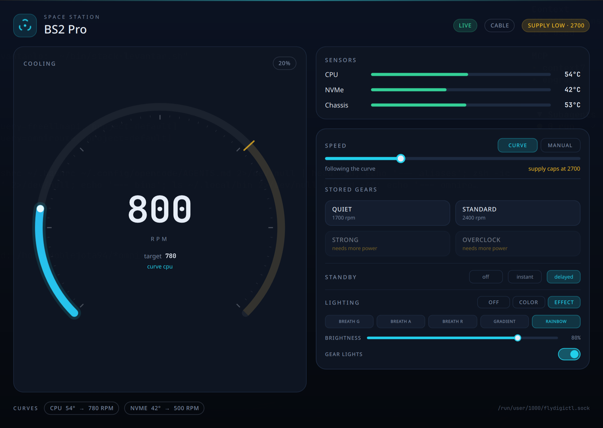

# Flydigi BS2 Pro Control for Linux

[](https://github.com/ddoblejotadev/flydigi-bs2pro-linux/actions/workflows/ci.yml)
[](https://github.com/ddoblejotadev/flydigi-bs2pro-linux/stargazers)
[](LICENSE)

A native Qt 6/QML control panel for the Flydigi BS2 Pro cooler on Linux. It provides a resident desktop dashboard, official cooling gears, Smart Speed/AUTO, a bounded custom curve editor, and the lighting controls supported by the **built-in Linux daemon**.



> **Architecture:** This project includes a **built-in daemon** that owns hardware access (HID/Bluetooth) and communicates with the GUI through a Unix socket. No external daemon dependency is required.

## Quick install

### AppImage — any Linux distribution

1. Download the latest `flydigi-bs2pro-linux-*-x86_64.AppImage` from [Releases](https://github.com/ddoblejotadev/flydigi-bs2pro-linux/releases).
2. Mark it executable in your file manager, or run:

   ```sh
   chmod +x flydigi-bs2pro-linux-*.AppImage
   ```

3. Double-click the AppImage to launch it. The application does not require a terminal.
4. The built-in daemon handles hardware access automatically.

The AppImage contains the GUI, the built-in daemon, and the Qt/QML runtime. No external daemon dependency.

To install or update interactively, download `flydigi-installer` from the same release, make it executable, and run it:

```sh
chmod +x flydigi-installer
./flydigi-installer
```

The installer shows the installed/latest version and release notes, verifies `SHA256SUMS` before replacing the AppImage, asks for confirmation, and keeps the previous version for rollback. It does not use `sudo` or control the cooler daemon. If you prefer to inspect it first, download it as a normal release asset; never pipe an unknown script directly into a shell.

### Debian, Ubuntu, Linux Mint, and derivatives

1. Download `flydigi-bs2pro-linux_*_amd64.deb` from [Releases](https://github.com/ddoblejotadev/flydigi-bs2pro-linux/releases).
2. Open it with the graphical package installer, or run:

   ```sh
   sudo apt install ./flydigi-bs2pro-linux_*_amd64.deb
   ```

3. Open **Flydigi BS2 Pro Control** from the application menu.

The `.deb` installs the GUI, the built-in daemon, desktop entry, icon, and QML resources. No external daemon required.

### Arch Linux and Omarchy

The project does not publish an Arch package yet. Use the AppImage for the easiest local installation:

```sh
mkdir -p ~/.local/opt/flydigi-bs2pro-linux
install -m755 flydigi-bs2pro-linux-*.AppImage ~/.local/opt/flydigi-bs2pro-linux/flydigi-bs2pro-linux.AppImage
```

Then launch it from the file manager. To add it to the application menu, create `~/.local/share/applications/flydigi-bs2pro-linux.desktop`:

```ini
[Desktop Entry]
Type=Application
Name=Flydigi BS2 Pro Control
Comment=Control a Flydigi BS2 Pro cooler
Exec=/home/YOUR_USER/.local/opt/flydigi-bs2pro-linux/flydigi-bs2pro-linux.AppImage
Icon=flydigi-bs2pro-linux
Terminal=false
Categories=System;HardwareSettings;Settings;
```

Replace `YOUR_USER`, copy `packaging/flydigi-bs2pro-linux.svg` to `~/.local/share/icons/hicolor/scalable/apps/`, and refresh the desktop database if your environment requires it. Omarchy users can then launch it from the application launcher.

### Build from source

Dependencies: Linux, Qt 6.5+ (`Core`, `Gui`, `Qml`, `Quick`, `Network`, `Widgets`, `Test`), Rust 1.75+, and CMake 3.21+.

```sh
cmake -S . -B build -DCMAKE_BUILD_TYPE=Release -DBUILD_TESTING=ON
cmake --build build -j"$(nproc)"
ctest --test-dir build --output-on-failure
cmake --install build --prefix "$HOME/.local"
```

The installed executable is `flydigi-bs2pro-linux`; the daemon is built and installed as `flydigi-bs2pro-linux-daemon`; the desktop entry appears as **Flydigi BS2 Pro Control**.

## Architecture

```
┌─────────────────┐     Unix socket      ┌──────────────────┐
│   GUI (Qt/QML)  │ ◄──────────────────► │  Built-in Daemon │
└─────────────────┘  (newline JSON)      └────────┬─────────┘
                                                  │
                                    ┌─────────────┴─────────────┐
                                    ▼                           ▼
                              HID USB                        Bluetooth
                                    │                           │
                              /dev/hidraw*                    /dev/hidraw*
```

- **GUI** (`flydigi-bs2pro-linux`): Qt 6/QML resident dashboard with system tray integration.
- **Daemon** (`flydigi-bs2pro-linux-daemon`): Owns HID/Bluetooth access, exposes newline-delimited JSON over Unix socket at `/run/user/$UID/flydigi-bs2pro-linux.sock`.
- **No external daemon required** — the daemon is built and shipped with the project.

## What works

### Cooling

- Explicit AUTO/Smart Speed state from daemon readback.
- Linux manual override separate from official Smart Speed and fixed gears.
- Official fixed gears with three speed levels:

  | Gear | RPM levels |
  | --- | --- |
  | Quiet | 1300, 1700, 1900 |
  | Standard | 2100, 2400, 2700 |
  | Strong | 2800, 3000, 3300 |
  | Overclock | 3500, 3700, 4000 |

- Supply limits disable unavailable levels instead of sending invalid requests.
- Quiet, Performance, and Custom Smart Speed presets.
- Eight-point custom curve editor with 30–100 °C temperature bounds and supply-aware RPM validation.
- State changes are shown as active only after daemon confirmation.

### Lighting

- Verified side-strip ON/OFF control with daemon ACK and `0x45` readback.
- Accessible Strip on/off switch with mouse and keyboard support.
- Brightness, custom colors, presets, and animated effects remain disabled until BS2 Pro-specific frames and pattern readback are verified.
- The official Windows lighting data model was analyzed for future work, but it is not treated as proof of Linux HID-frame compatibility.

### Resident desktop behavior

- Closing the window or pressing Escape hides it when a tray host is available.
- The tray provides **Show Space Station** and **Quit** actions.
- Without a tray host, close falls back to minimizing for task-switcher recovery.
- The GUI remains independent from the daemon while hidden.

## Hardware verification

The following behavior was observed with a real BS2 Pro:

- Notebook USB supply reports a 2700 RPM limit.
- Fast-charger transition reconnects over Bluetooth with a 4000 RPM limit.
- Strong reaches 3300 RPM over Bluetooth.
- Overclock reaches 4000 RPM over Bluetooth.
- Full cooler power-cycle reconnects and restores AUTO, curve, and lighting state.

Exact vendor curve values from the Windows application are not claimed as verified. Tachometer readings can briefly overshoot the requested target while settling.

## Performance and security notes

A local offscreen Release measurement of the installed GUI kept the process alive for 5 seconds with approximately **123 MiB RSS** and **0.00% process CPU** during a 5-second idle sample. This is a Qt/QML desktop baseline, not a claim about every compositor or hardware setup. The GUI remains resident while hidden; its CPU/RAM usage is not artificially throttled.

The GUI uses `QLocalSocket` only, does not execute shell commands, spawn processes, write HID devices, or request elevated privileges. Socket ownership and access permissions remain the daemon's security boundary. The built-in daemon runs with minimal privileges and uses `hidraw` character devices directly; packages do not install services, modify udev rules, or broaden device permissions.

## Build release artifacts

The repository includes reproducible packaging entry points:

```sh
# Requires linuxdeploy, linuxdeploy-plugin-qt, and appimagetool
packaging/build-appimage.sh 0.1.0

# Requires dpkg-deb; normally run on Debian/Ubuntu or CI
packaging/build-deb.sh 0.1.0
```

Both scripts package the GUI and the built-in daemon. No external daemon dependency.

## Troubleshooting

### The GUI shows “NO DAEMON”

Check the built-in daemon process and socket:

```sh
pgrep -a flydigi-bs2pro-linux-daemon
ls -l /run/user/$UID/flydigi-bs2pro-linux.sock
```

Start the daemon manually if needed:

```sh
flydigi-bs2pro-linux-daemon
```

For a custom socket:

```sh
flydigi-bs2pro-linux --socket /path/to/daemon.sock
```

### A control appears inactive

The UI waits for daemon readback. A request written to the socket is not treated as confirmation; wait for the next status response and inspect the daemon log.

### Report a problem

Include the GUI version, daemon version, distribution, desktop/compositor, exact steps, daemon logs, and whether the hardware was connected. Report issues at the [GitHub issue tracker](https://github.com/ddoblejotadev/flydigi-bs2pro-linux/issues).

## License

MIT. See [LICENSE](LICENSE).

## Credits

Reverse-engineering evidence and workflow were provided by the [Reverse Engineering Assistant (REA) repository](https://github.com/doblejota/rea).